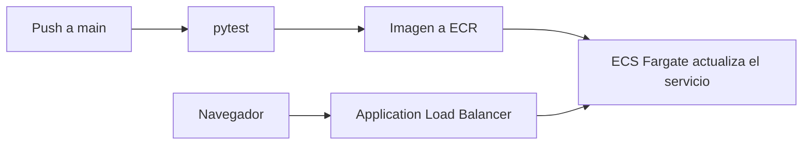

# YucaCore DC Ops Dashboard

**[Read in English](README.md)**

Dashboard de operaciones para **YucaCore**, un operador ficticio de colocation y nube híbrida con sitio principal en Querétaro y sitio de borde en Mérida. La bitácora de incidentes, las solicitudes de acceso y el checklist de seguridad son un caso de estudio. Los benchmarks que aparecen al lado son cifras tomadas de reportes públicos: cada página las cita, y los archivos viven en [`data/`](data/README.md).

[](https://github.com/kevin080106/dc-dashboard/actions/workflows/deploy.yml)
[](LICENSE)

## Cómo correrlo

Python 3.11 o posterior:

```bash
python3.11 -m venv .venv
source .venv/bin/activate
pip install -r requirements-dev.txt
streamlit run app.py
```

Abre http://localhost:8501. El Makefile expone lo mismo con `make run` y `make test`.

La imagen de contenedor es la que corre en producción:

```bash
docker build -t yucacore-dashboard .
docker run --rm -p 8501:8501 yucacore-dashboard
```

## Para qué sirve cada página

| Página | Pregunta que responde |
| --- | --- |
| [Operaciones](pages/01_operations.py) | ¿Dónde queda la bitácora del caso frente al costo y la causa publicados de las caídas? |
| [Energía](pages/02_energy.py) | ¿Qué PUE sale de un par de consumos, y cómo se compara con el promedio 2024 de 1.56? |
| [Seguridad](pages/03_security.py) | ¿Qué controles físicos tiene el caso, con el vocabulario de ISO/IEC 27001 y ANSI/TIA-942? |
| [Mercado](pages/04_market.py) | ¿Cómo se reparten, en la foto guardada, los centros de datos de México y los indicadores LATAM 2025? |
| [Tecnologías emergentes](pages/05_emerging_tech.py) | ¿Qué capacidad y qué peso de cargas de IA publican los reportes citados hacia 2030? |

Los conteos de mercado son una foto en `data/market_mexico.csv`, no un directorio en vivo. El total de México en esa página es la suma del archivo (173 instalaciones en la foto actual). En energía, los valores iniciales reproducen un PUE de 1.56: la comparación arranca en el promedio publicado y se mueve cuando cambian los insumos.

PUE es la energía total de la instalación dividida entre la energía del equipo de TI, en el mismo periodo. La unidad se cancela. Un resultado menor a 1.0 se marca como no plausible, porque la energía de la instalación ya incluye la carga de TI.

## Stack

Python, Streamlit, pandas y Plotly. En producción el runtime es un contenedor en ECS Fargate detrás de un Application Load Balancer. Terraform define los recursos de AWS. GitHub Actions corre las pruebas, publica la imagen en ECR y fuerza un despliegue nuevo. El detalle está en [`infra/README.md`](infra/README.md).



Un pull request corre las pruebas y no despliega. Un push a `main` despliega solo si esas pruebas pasan.

## Estructura

```text
app.py                  Enrutador: configuración, estilo común y navegación
pages/                  Inicio y una página por sección
utils/data_loader.py    Lectura de CSV y búsquedas por llave
utils/metrics.py        Definición de PUE y formato de cifras
utils/charts.py         Tema de Plotly y gráficas de barras
utils/ui.py             Estilo, tablas y citas
data/                   Tablas de la foto y sources.csv
tests/                  Fórmula, cifras citadas y orden de las gráficas
infra/                  Terraform: ECR, ECS, balanceador y logs
.github/workflows/      Pruebas y, en main, despliegue
Dockerfile
```

Las cifras citadas están fijas en `tests/test_data.py`. Si actualizas una cifra publicada, el CSV y la prueba cambian en el mismo commit.

Los diccionarios de columnas y la nota de infraestructura están en inglés, junto al código: [`data/README.md`](data/README.md) y [`infra/README.md`](infra/README.md).

## Licencia

[MIT](LICENSE).
