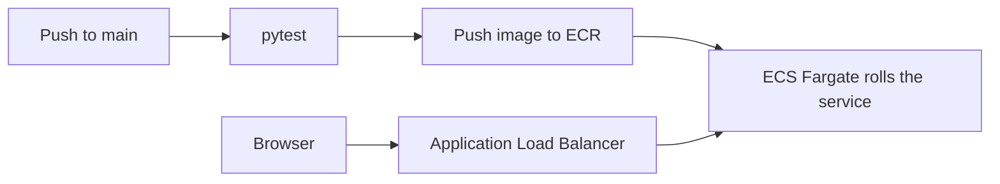

# YucaCore DC Ops Dashboard

**[Leer en español](README.es.md)**

Operations dashboard for **YucaCore**, a fictional colocation and hybrid-cloud operator with a primary site in Querétaro and an edge site in Mérida. The incident log, access requests, and security checklist are a case study. The benchmarks next to them are figures copied from public industry reports, cited on each page and stored in [`data/`](data/README.md).

[](https://github.com/kevin080106/dc-dashboard/actions/workflows/deploy.yml)
[](LICENSE)

## Run it

Python 3.11 or newer:

```bash
python3.11 -m venv .venv
source .venv/bin/activate
pip install -r requirements-dev.txt
streamlit run app.py
```

Open http://localhost:8501. The same entry points live in the Makefile as `make run` and `make test`.

Container image, the same one production runs:

```bash
docker build -t yucacore-dashboard .
docker run --rm -p 8501:8501 yucacore-dashboard
```

## What each page is for

| Page | Question it answers |
| --- | --- |
| [Operations](pages/01_operations.py) | Where does the case-study incident log sit next to published outage cost and cause? |
| [Energy](pages/02_energy.py) | What PUE does a facility energy pair produce, and how does it compare with the 2024 average of 1.56? |
| [Security](pages/03_security.py) | Which physical controls are in place in the case, using ISO/IEC 27001 and ANSI/TIA-942 vocabulary? |
| [Market intelligence](pages/04_market.py) | How are Mexico facility counts and 2025 LATAM indicators distributed in the saved snapshot? |
| [Emerging technologies](pages/05_emerging_tech.py) | What capacity and AI-workload figures do the cited outlooks publish through 2030? |

Market counts are a snapshot in `data/market_mexico.csv`, not a live directory. The Mexico total on that page is the sum of the file (173 facilities in the current snapshot). The energy page defaults reproduce PUE 1.56 so the comparison starts on the published average and moves when the inputs change.

PUE is total facility energy divided by IT equipment energy over the same period. The unit cancels. A result below 1.0 is rejected in the interpretation because facility energy already includes the IT load.

## Stack

Python, Streamlit, pandas, and Plotly. The production runtime is a container on ECS Fargate behind an Application Load Balancer. Terraform defines the AWS resources. GitHub Actions runs the tests, publishes the image to ECR, and forces a new deployment. Details are in [`infra/README.md`](infra/README.md).



A pull request runs the tests and does not deploy. A push to `main` deploys only after those tests pass.

## Layout

```text
app.py                  Router: page config, shared chrome, navigation
pages/                  Overview, then one page per section
utils/data_loader.py    CSV reads and keyed lookups
utils/metrics.py        PUE definition and figure formatting
utils/charts.py         Shared Plotly theme and bar charts
utils/ui.py             Page chrome, tables, citations
data/                   Snapshot tables and sources.csv
tests/                  Metric math, cited figures, chart order
infra/                  Terraform for ECR, ECS, the load balancer, logs
.github/workflows/      Test, then deploy on main
Dockerfile
```

Cited numbers are locked in `tests/test_data.py`. Updating a published figure means updating the CSV and the test in the same change.

## License

[MIT](LICENSE).
